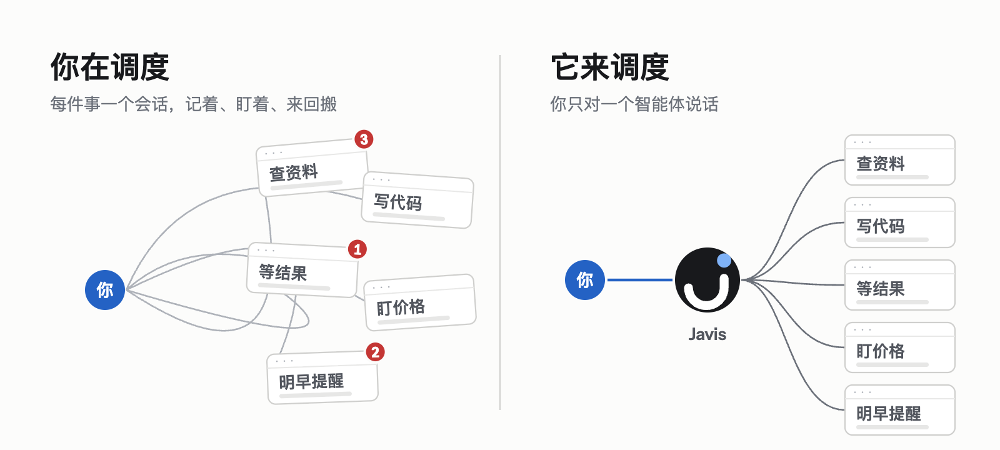

> 本文是一篇面向工程实践的设计介绍。Javis目前为0.1版，准备以Apache-2.0开源（地址后补）。

## 1. 从对话到常驻

今天的智能体大多由对话驱动：收到一条消息，循环调用模型和工具，给出回答，结束。单个任务它已经做得不错，不够用的反而是人的注意力[[2]](https://mp.weixin.qq.com/s/zoS7GlReWPhfCjENGxXCdg)。

事情一多，人就会同时开几个会话，一个查资料，一个写代码，一个等结果。哪个会话在做什么要人记着，进展要人隔一会儿回去看，一个会话的结论要人搬到另一个会话里。调度其实是人在做，而一个人同时跟得住的会话也就三五个[[2]](https://mp.weixin.qq.com/s/zoS7GlReWPhfCjENGxXCdg)。

个人助手的事情还要更散。"气温低于4.5度告诉我"要等一个条件，"明早提醒我"要等一个时刻，"这份资料你慢慢查"要等一段工作做完。每件事开一个会话，就是多几个要人记着回去看的窗口，而且它们有一个共同点：**开始的时候用户在场，该行动的时候用户不在场。**

所以Javis让用户只对一个智能体说话，记什么、派什么、等什么、什么时候开口，由它来管。判断和执行因此分成两层，类似[[2]](https://mp.weixin.qq.com/s/zoS7GlReWPhfCjENGxXCdg)里的Router和Worker，在Javis里叫主线和任务。

Javis部署在自己的机器上，通过网页使用。下图是演示账号里的一段真实运行，用户在一分钟内发了三条消息（盯气温、后台查一份清单、两分钟后提醒喝水），此后的三轮都由事件触发：

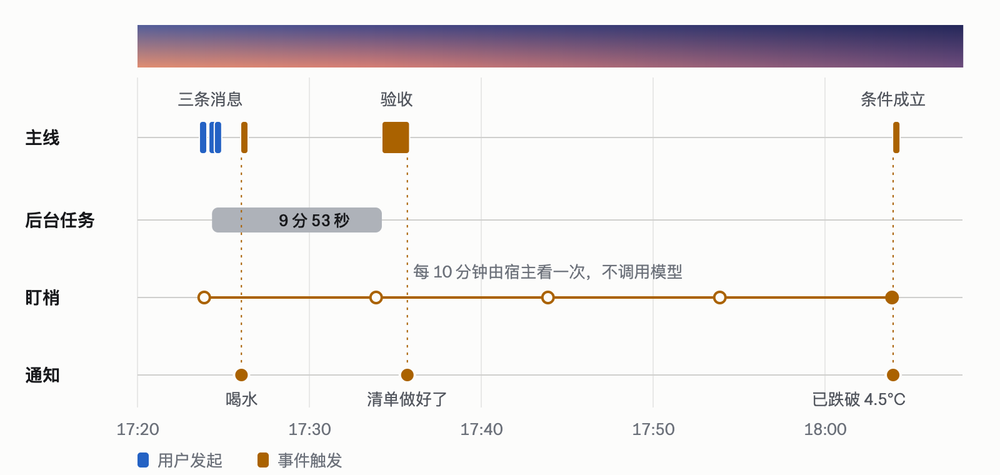

*图1：2026年11月25日傍晚的一次真实运行，时间取自数据库（盯梢的中间几次检查按间隔推算）。提醒到点、任务完成、条件成立，各自开启一轮*

下文的图沿用同一套约定：**蓝色是有人在场、由用户发起的，琥珀色是没有人在场、由事件触发的。**

要支持这样的使用方式，一个常驻的个人智能体需要具备四个特征：

- **连续**：用户面对的始终是同一个智能体，昨天交代的事今天不用再说一遍。
- **不阻塞**：它在做长活的时候，仍然能听、能回应、能准点提醒。
- **克制**：能自己判断什么值得打扰，不需要开口时保持安静。
- **可控**：没有人在场的时候，它能动用的权限比有人在场时更小。

四个特征之间有张力。连续要求信息汇到一处，不阻塞要求工作分散出去；主动行动得越多，克制和可控就越难。下文依次介绍Javis的取舍：用主线与任务兼顾连续与不阻塞（第2节），用事件驱动让它在用户不在场时行动（第3节），把能力都做成命令、按需展开（第4节），用上下文布局和记忆支撑一条不结束的对话（第5节），用按发起者定级的权限做到可控（第6节），用默认安静的通知做到克制（第7节）。第8节给出实测，第9节讨论尚未解决的问题。

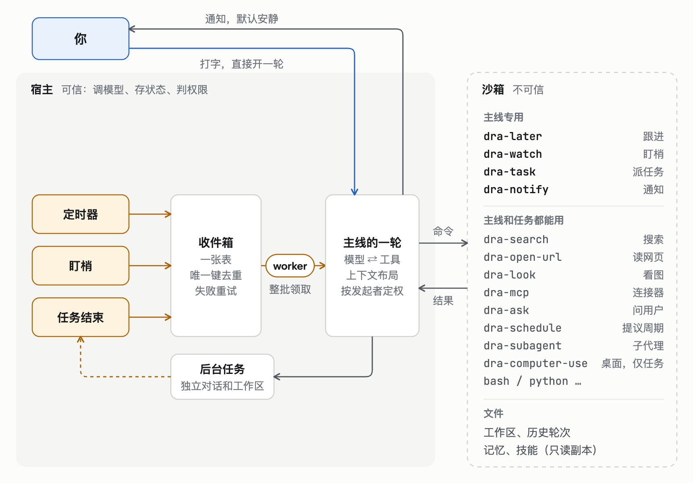

*图2：整体架构。你打字直接开一轮，其余来源先进收件箱，由worker整批领取；结果以通知回到你*

贯穿全文的是图中的信任边界。模型写的命令和读到的网页都在**沙箱**（Docker容器或e2b）里，**宿主**负责调用模型、保存状态和执行权限。凡是要紧的判断，比如这一轮是谁发起的、能用哪些凭据，都在宿主做，不采信沙箱一侧的说法。

## 2. 主线与任务

### 2.1 连续与不阻塞的取舍

事件来了交给谁处理，有两种直接的做法。全部交给同一个会话，上下文最连续，但循环是串行的，一个20分钟的调研会让到点的提醒排队，调研的中间过程也会留在上下文里。每个事件新开一个会话，也就是第1节说的现状，互不阻塞，但各会话没有共同的记忆，好几个声音同时对用户说话，调度又落回人身上。

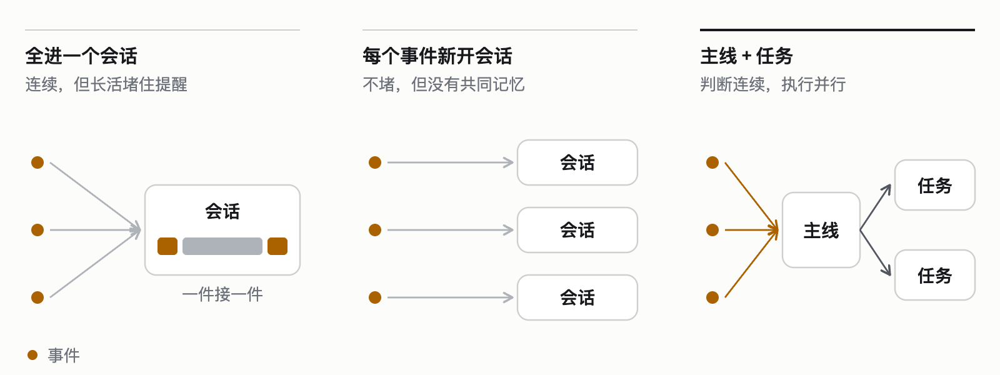

*图3：判断集中在一条主线，执行分散到任务*

Javis把两件事拆开。**主线**是一条固定的、不会结束的对话，所有消息和事件都汇到这里，由它判断和派活。**任务**是为一件长活单独开的对话，有自己的上下文和工作区。主线像管家，听、判断、交代、验收；任务像工人，领一份说明，把活干完，交回结果。

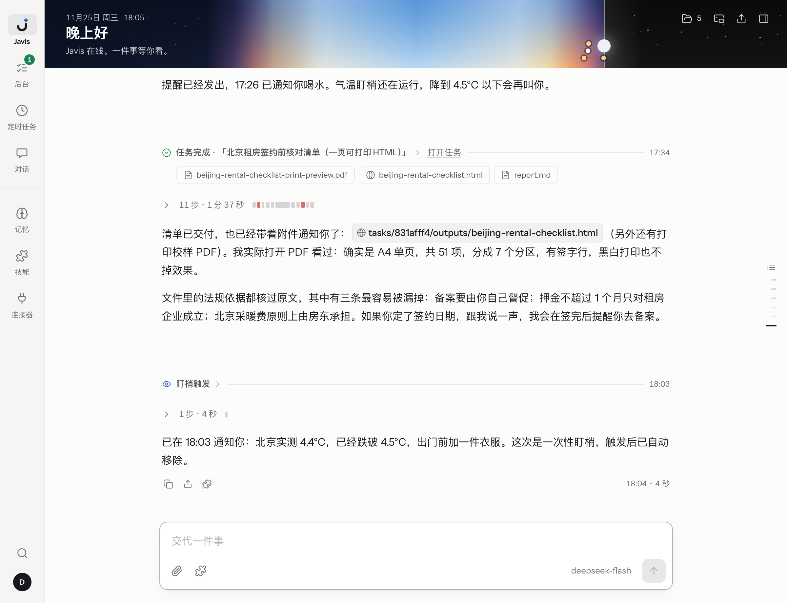

*图4：主线界面。任务完成和盯梢触发各是一轮，顶部是这一天的天色和当天的事件*

### 2.2 任务是一条普通对话

任务没有引入新的运行时，就是一条普通对话。流式查看、停止、断线重连、子代理、上下文压缩，这些能力原样可用，用户随时可以点进去看过程、插话，结束之后接着聊。新增的只有一点：任务结束时，宿主写入一条事件，主线因此被叫醒。

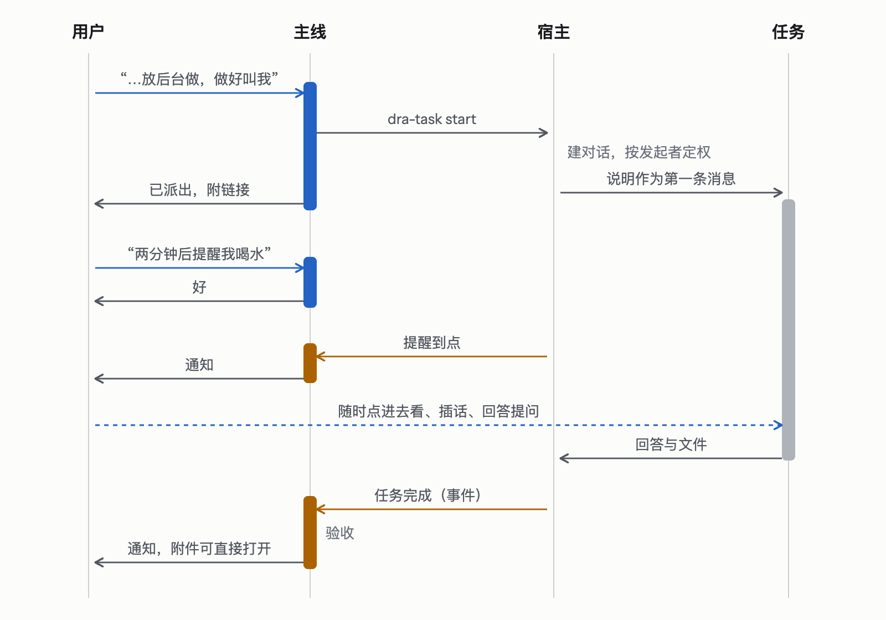

*图5：主线派完活即结束本轮，任务结束以事件形式回来*

几条约束让两层不至于纠缠：

- 任务不能再开任务，也不能直接发通知，汇报统一经过主线。例外是任务停下来等用户时（提问、扫码登录），由宿主直接通知。
- 任务对长期记忆只读，学到的东西写进最终回答，由主线决定记不记。
- 用户进任务里看过、插过话，不会为此叫醒主线，只在主线下一轮的上下文里带上一句。叫醒一次，中位数要花二十几万token，主线还会把用户刚看过的东西再核对一遍。
- 每个工作区只有一个写者。主线要看产物，由宿主复制一份；要修改，就请任务去改；要给材料，由宿主放进任务的收件目录，只增不改。

最后一条看似琐碎，实际省掉了很多混乱。任务里的`outputs/x.md`和主线里的`outputs/x.md`是两个文件，模型转述路径时很容易张冠李戴，因此交付物一律以`tasks/<id>/路径`引用，由宿主解析到任务里的原件。

### 2.3 让它真的派活

结构搭好之后，模型未必会用。最初的做法是在主线的提示词里加一条"长活交给任务"。实测让它写一份对比报告，它用10次工具调用、78秒自己写完了。从推理过程看，它遵循的是提示词前部"第一步规划，第二步执行"的工作流，后面追加的规则没有起作用。

因此主线换了一份独立的工作流，第一步是**判断这件事该在哪里做**，并给出可数的标准：需要正经调研、有交付物，或预计超过约5次工具调用，就交给任务；拿不准，也交给任务。

## 3. 事件驱动

### 3.1 一次run

常驻的智能体并非一直在运行。它大部分时间在睡，被事件叫醒，跑一轮，把需要留下的写回去，再睡。两次之间没有模型在跑，也不消耗token。

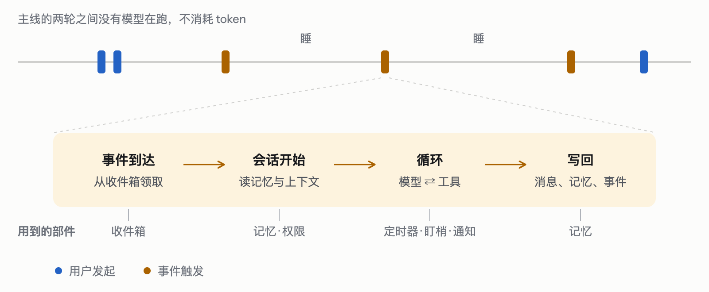

*图6：一次run的四步，以及每一步用到的部件*

### 3.2 收件箱

除了用户打字，其他来源都不直接启动一轮，只往**收件箱**里写一行。收件箱是一张数据库表，由唯一的worker读取：主线空闲时，把积压的事件一次领走，合成一条消息，跑一轮。

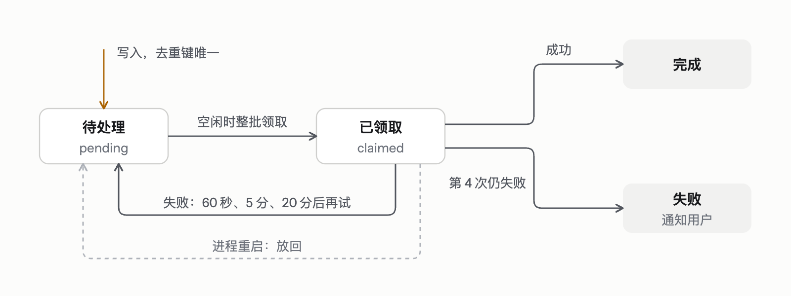

*图7：事件的状态流转*

这张表承担了大部分可靠性：

- **写入恰好一次。** 每个事件带去重键，例如某个定时器的某次触发。重复写入会撞上唯一约束，生产者可以放心重试。
- **处理至少一次。** 进程崩溃后，已领取但没处理完的事件放回队列重跑。崩溃前可能已经发过通知，所以重跑时宿主会在消息开头说明情况，要求先检查再行动。
- **坏事件不连累别人。** 合并的副作用是一条坏事件会让整批失败，因此到了最后一次重试，它会被单独领取。
- **放弃要说出来。** 四次仍失败的事件标记为失败，并通知用户。

一轮跑到一半又来了新事件怎么办？事件留到下一轮，这样一轮的权限和上下文不会中途改变；用户打字则不同，它会在当前这一步结束后插进来，因为人的话应该尽快被听到。

### 3.3 定时器与盯梢

时间和条件是两类最常见的等待。

**定时器**分为一次性的跟进和周期任务。跟进由智能体自己设定，比如它答应了"两小时后再看看"。周期任务必须由用户确认：智能体只能提议，用户在卡片上点了才创建。这条规则来自一次测试，当时只有一次性提醒，用户说"每天9点提醒我"，模型定了一个提醒，在备注里写上"到时再定下一次"，然后回复"每天都会提醒"。这条链没有人确认过，任何列表里都看不出它是周期的，中途失败一次就会无声地断掉。

**盯梢**等的是条件：网页变化、数值越线、订阅源有新条目。如果每次都叫醒模型去看一眼，绝大多数结论是"还没到"。Javis让宿主按间隔抓取并用普通代码判断，条件成立才写事件，在此之前不产生模型费用。触发采用边沿方式，条件从不成立变为成立的那一次才算。

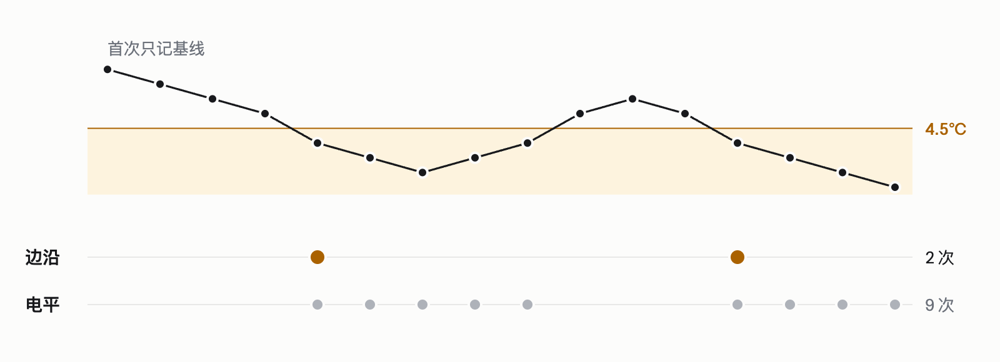

*图8：示意。同一段气温，边沿触发叫醒两次，电平触发叫醒九次*

## 4. 能力都是命令

### 4.1 为什么是命令

上面这些能力都没有做成专门的工具协议，而是沙箱里的命令，模型会写bash就会用：

```bash
dra-later  --in 2h "查一下快递到了没有"
dra-watch  add --url … --json current.temp --below 6.5 --once "提醒加衣服"
dra-task   start --title "租房核对清单" "…"
dra-notify "清单做好了"
```

主循环交给模型的工具其实只有两个，执行bash和编辑文件。搜索、读网页、看图、子代理、连接器、派任务、设提醒，都是`dra-*`命令。这是前身项目DeepResearchAgent定下的做法，前缀dra也由此而来[[6]](https://github.com/Paul33333/tinymind-blog/blob/main/content/blog/cli-is-all-you-needdeepresearch-%E5%A4%9A%E6%99%BA%E8%83%BD%E4%BD%93%E6%9E%B6%E6%9E%84%E5%8D%87%E7%BA%A7%E2%80%94%E5%AE%9E%E8%B7%B5%E5%88%86%E4%BA%AB.md)，当时的理由是省掉自定义工具协议的解析，工具说明也能按需加载。后来几个公开的极简智能体给了更直接的佐证。

pi只给模型读、写、改、bash四个工具，系统提示词连同工具定义不到1000 token。作者的解释是，模型已经被大量强化学习训练成了编码智能体，用不着再花上万token告诉它该怎么做[[7]](https://mariozechner.at/posts/2025-11-30-pi-coding-agent/)。Vercel把内部一个text-to-SQL智能体的工具砍掉八成，只留执行bash，五个代表性问题从对4个变成全对，平均耗时从275秒降到77秒，token少了约四成[[8]](https://vercel.com/blog/we-removed-80-percent-of-our-agents-tools)。DeepSeek Harness的sdk-minimal只有一个持久的shell和一个看图工具，系统提示词就一句"You are a helpful software engineer assistant."，仓库的评测说明也是让人用这个极简变体来跑[[9]](https://deepseek-harness.github.io/deepseek-harness/en/guide/python-sdk)。

这样做能成立，原因大致有三条。一是bash和文件是模型在训练里见得最多的接口，用它熟悉的方式给能力，它不用先学一套新协议，出了错也看得懂报错。二是工具列表固定，系统提示词才能逐字节不变，前缀缓存（第5.1节）不会因为接了一个服务、关了一个连接器而失效。三是命令可以组合，输出能进管道、写文件、交给python，大结果不必整段过一遍上下文。对Javis还有一条工程上的好处：同一条命令，主线、任务、在沙箱里跑的子代理都能用，不用各写一遍工具。

但也不是什么都该退回裸bash。Vercel后来请Braintrust做过一组对照：在结构清楚的数据上答题，初版里SQL智能体准确率100%，纯bash只有52.7%，token多了近七倍；修掉几个问题后差距缩小，但结论仍是结构化数据用SQL最直接，bash更适合探索和核对[[10]](https://vercel.com/blog/testing-if-bash-is-all-you-need)。所以Javis的骨架只留bash，常用的能力做成专门的命令，参数校验、输出格式和出错提示由命令负责，模型只管调用。

### 4.2 命令只是桩

Javis自己的几条命令（`dra-later`、`dra-watch`、`dra-task`、`dra-notify`）在沙箱里只是**桩**：校验参数，打印一行标记，真正的动作由宿主读到标记后执行。需要防的是伪造，网页里完全可能藏着一行一模一样的标记，被`curl`打印出来。因此宿主只在这条命令确实调用了对应工具时才认账，判断之前先剔除引号和heredoc里的内容，因为那些是数据。

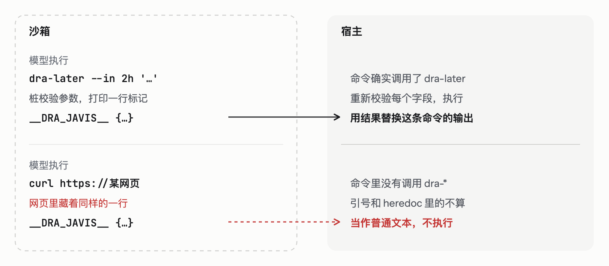

*图9：同样一行标记，认不认取决于命令本身*

这样设计是为了让骨架保持薄。宿主只提供事件、worker和通知，其余都是模型可以选择不用的命令，不往每一轮里塞固定流程。

### 4.3 一层一层地展开

命令的另一个好处是说明可以分层，用到哪层才展开哪层。连接器最能说明这一点。

MCP的常规接法是把服务器的工具全部注册成模型的工具，说明和参数schema每一轮都要带上。Mario Zechner量过，Playwright的MCP服务器21个工具占13.7K token，他换成几个命令加一份README，只要225 token[[11]](https://mariozechner.at/posts/2025-11-02-what-if-you-dont-need-mcp/)。对Javis来说还有一层：接上或关掉一个连接器，工具列表就变了，前缀缓存跟着失效。

所以连接器只通过`dra-mcp`访问，模型看到的内容分四层：

| 层 | 在哪里 | 看到什么 |
|---|---|---|
| 1 | 系统提示词 | 每个连接器一行：名字、说明、最多12个工具名、是否已登录，按名字排序 |
| 2 | `dra-mcp tools 服务器` | 每个工具一行：名字、参数（必填的带星号）、一句说明 |
| 3 | `dra-mcp schema 服务器 工具` | 完整说明、输入输出schema、是否只读的标注 |
| 4 | `dra-mcp call 服务器 工具 '{…}'` | 真正调用 |

代价是参数的JSON要模型自己写。为此`call`在发请求之前先按缓存的schema查一遍，缺了必填项、类型不对、多了不允许的字段，都直接退出并打印schema，不碰服务器。

用不了的连接器（没登录、令牌刷新失败、定时任务没选它）也不会从提示词里消失，而是写明名字和原因。否则模型会以为用户根本没接Notion，或者悄悄改用网页搜索，定时任务就把打了折扣的结果当成功交差。

同样的分层也用在别处：

- 技能：提示词里只有名字、说明和路径，任务对上了，模型自己去读那份SKILL.md；用户在输入框里点选的技能，才把全文附在这一轮的消息里。
- 命令输出：过长的只留头尾进上下文，全文落成文件，需要时再查。
- 历史和记忆：移出窗口的轮次是文件（第5.2节），记忆按变化频率放在请求的不同位置（第5.3节）。

上下文里放的是目录，正文在文件和命令后面。

## 5. 一条不结束的对话

### 5.1 给变化单独留一个位置

主线每一轮都需要知道当前时间、未了事项、盯梢和任务状态。最自然的写法是放进系统提示词，但前缀缓存从头逐字匹配，前面变一个字，后面就全部重算。时间每分钟都在变，于是每一轮都从头开始。

Javis的做法是让系统提示词逐字节不变，所有会变的内容放到最后一条消息末尾的`<turn_context>`，只在请求时拼接，不写入历史。

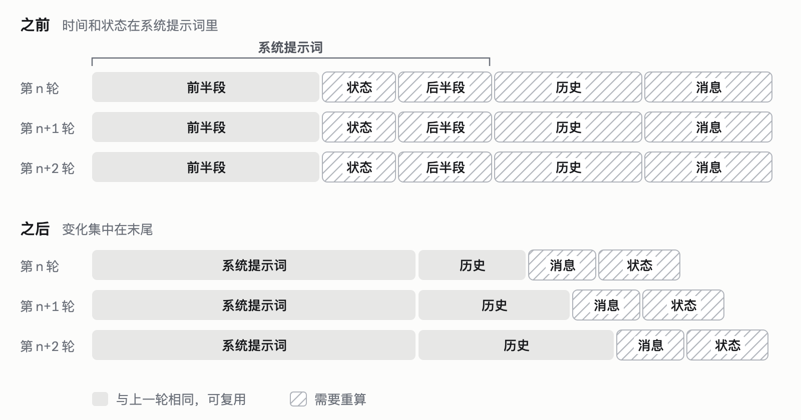

*图10：把变化移到末尾之后，前缀可以一直复用（示意，宽度不代表token数）*

### 5.2 按台阶移动的历史窗口

主线不结束，历史必须截断。常见的做法是只保留最近若干条，每轮滑动一格。这样每轮都会丢掉窗口头部的一条，其后的前缀又全部失效。

Javis让窗口的起点只落在固定的位置上，每10条消息一个台阶。对话往后长，起点不动；窗口满了，起点才往前跳一个台阶，大约每5轮一次。两次跳动之间，每一轮都只是在上一轮的末尾追加。


*图11：灰色与上一轮相同，斜线需要重算*

第8.2节给出两种方式的对比。被移出窗口的轮次保留完整过程，以文件形式放在沙箱里，需要时检索，不需要时不占上下文。

### 5.3 记忆

窗口之外的连续性由记忆承担。记忆是一组Markdown文件，用户可以直接编辑，每次改动都能撤销。放在请求的哪个位置，由变化的频率决定。

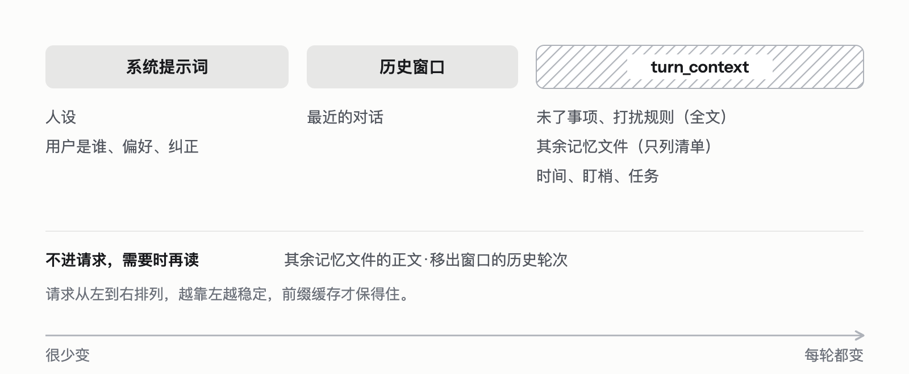

*图12：记忆按变化频率分布在请求的不同位置*

文件的好处是人和模型都能直接读写，代价是模型习惯追加。前身项目里有一份记忆文件被逐期追加到37 KB，其中89%是各期报告里已有的内容，真正有用的只是"下次从哪接着"那一行。因此它被约定为**当前状态，不是日志**：就地更新，解决了就删。写入后文件过大时，宿主会在返回里提示大小，因为模型平时看不到这个数字。

## 6. 没有人在场时的权限

### 6.1 风险从哪来

能访问私有数据、会读到不可信内容、能对外通信，三者同时具备，就可能被网页里的指令利用[[5]](https://simonwillison.net/2025/Jun/16/the-lethal-trifecta/)。常驻智能体天然具备这三条，而且启动某一轮的可能就是一段网页内容，旁边没有人看着。

### 6.2 权限跟着发起者走

Javis不按"这件事重不重要"判断权限，那需要模型自己评估，而模型可能已经被误导。它只看一个事实：**这一轮是谁发起的**。用户打字发起的轮次，可以使用连接器（Notion、GitHub等需要登录的外部服务）的全部工具；由提醒、盯梢、任务结果触发的轮次，只能使用只读工具。任务继承开它的那一轮的权限。

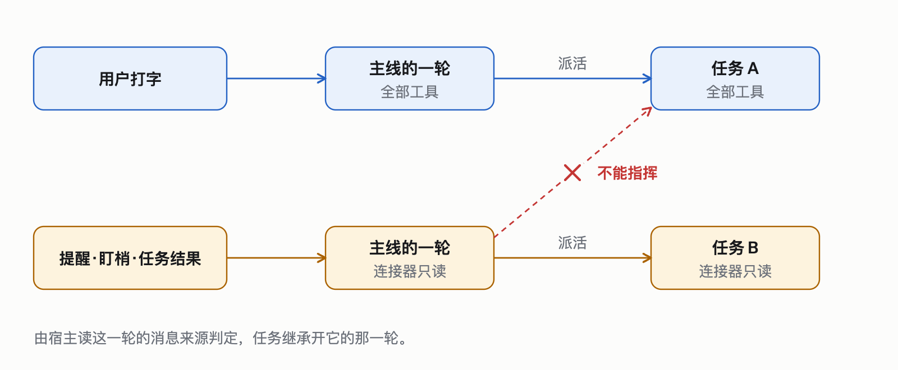

*图13：低权限的轮次不能指挥高权限的任务*

仅在源头定级还不够。如果一个只读的轮次可以给全权限的任务发指令，限制就被绕开了，这是经典的混淆代理问题。所以任务之间的每条通信路径都按同样的原则处理：只读轮次不能向正在运行的全权限任务发消息；主线发给任务的话都带来源标记，不会被当成用户的话。

### 6.3 让只读真正成立

只写在提示词里的只读没有约束力。在客户端工具里拦也不够，只要凭据在沙箱里可用，一条`curl`就能绕过去。

Javis在这类轮次里不给沙箱任何凭据，连接器只能经宿主上的**中继**访问。中继逐个检查请求，不在只读名单里的调用一律拒绝，解析不了的也拒绝，通过的才带上凭据转发。绕开中继直连，拿到的是401。

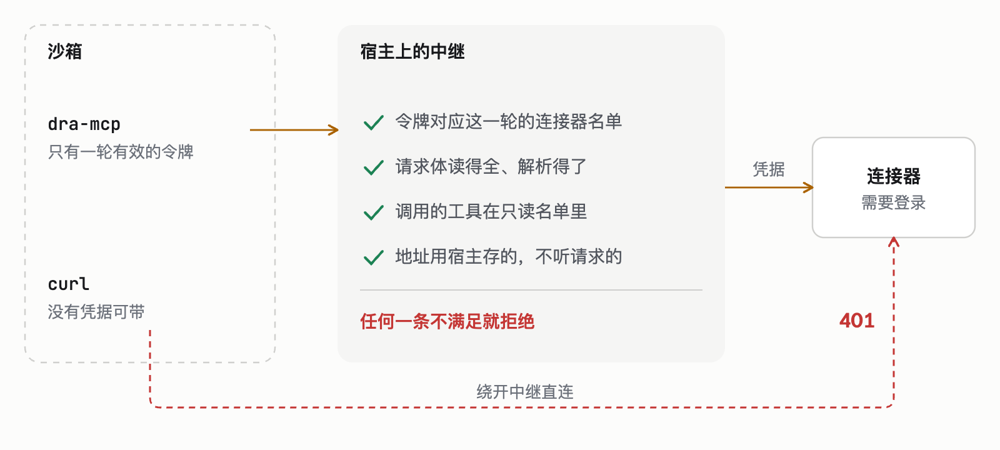

*图14：凭据和判断都在宿主一侧*

有人在场的轮次使用更宽松的方式，由沙箱外的代理给请求注入凭据。代理解决的是"凭据不泄露"，中继进一步解决"凭据不被用来做别的事"。

这套机制的边界也应当说清楚。用户打字发起的轮次及其任务是全权限，发送和付款没有强制确认；在独立对话里运行的定时任务，对用户为它勾选的连接器是全权限；不需要登录的连接器不受限制，沙箱可以联网；只读与否依赖连接器自己的标注。

## 7. 默认安静

一个常驻的智能体最容易犯的错误是话多。Javis的默认值是安静：没有人打字的轮次，最终回答只留在主线里当日志，只有显式执行`dra-notify`才会触达用户。提示词里另有两条，拿不准就不发，没有新情况不必汇报。通知通过Web Push送达，关掉页面也能收到。

什么值得打扰，因人而异。每条通知下面有"有用 / 不必打扰"两个选项，可以附一句原因。

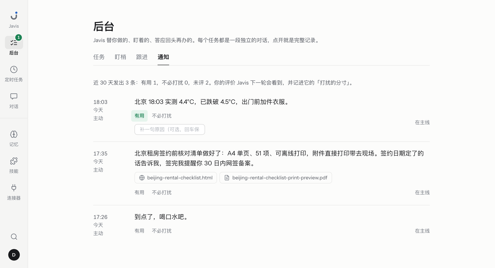

*图15：评价是数据，不会叫醒智能体*

评价不触发模型调用，只在下一轮的上下文里出现一次，由智能体归纳成规则，写进一份用户可编辑的文件。归纳出的规则可能与用户说过的话冲突，例如"到价告诉我"与"小波动不报"。此时以用户明确说过的为准，照常通知，并顺带询问是否要改。

## 8. 初步实测

以下数据来自作者一个人的使用环境，样本小，仅作参考。

### 8.1 易变内容对前缀缓存的影响

用约14.5K token的真实主线提示词，每次只改一处，观察命中的token数。

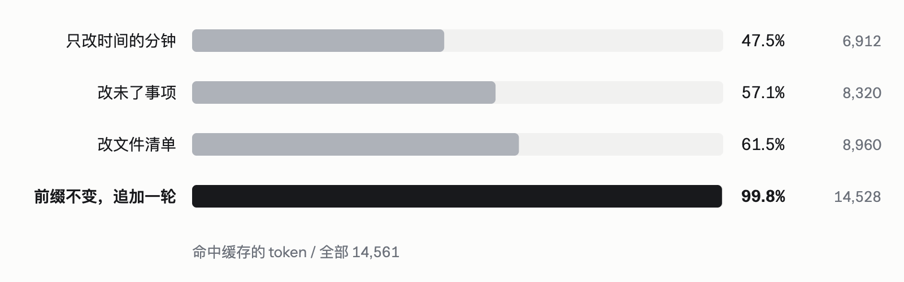

*图16：只改时间的分钟，命中停在47.5%；前缀不变则为99.8%*

调整布局之前，主线里只含一次模型请求的轮次，实际命中大多在0%到11%。

### 8.2 两种历史窗口

用主线208轮的真实消息长度回放，统计每轮首个请求与上一轮相同的前缀占比。

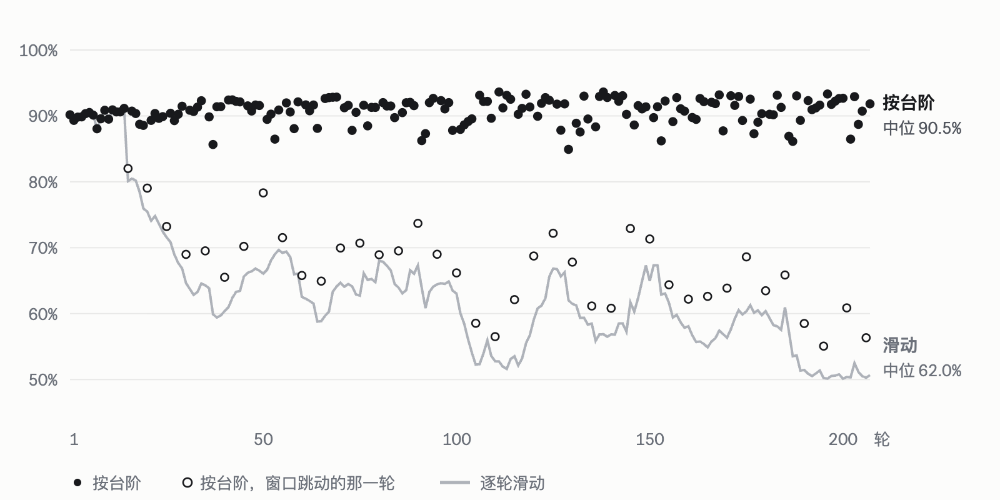

*图17：上限30条 / 60K字符；按字符计，未含工具定义，假设`<turn_context>`为3,000字符*

窗口填满之后，滑动方式跌到50%至70%，中位数62.0%；台阶方式大部分轮次在90%上下，每5轮左右跳一次，跳的那一轮跌到55%至82%，中位数90.5%。把`<turn_context>`的假设换成1,500或6,000字符，中位数分别为94.0%对64.1%、84.4%对58.1%，结论不变。需要说明的是，这是可复用前缀的占比，是命中率的上限，实际命中还取决于服务商。

### 8.3 成本

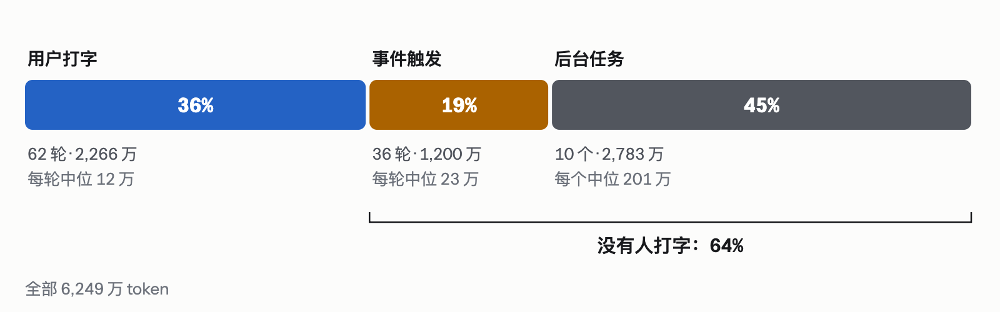

*图18：单人，2026年11月20日至26日，按发起方式分的token总量*

按总量计，64%的token花在没有人打字的轮次和后台任务上，后台任务一项就占了45%。常驻智能体的成本主要发生在用户看不见的地方。Javis目前只限制数量（3个并发任务、20个盯梢），没有花费预算。

## 9. 开放问题

**派活仍靠模型判断。** 第2.3节的工作流提高了派活的比例，但主线仍有bash，"小活"的边界仍由模型决定。更硬的办法是给主线的每一轮设工具调用预算，或者干脆不让它执行。DeepSeek的消融实验显示，单会话在中性提示下5次运行一次都没有委派，提示优先委派后仍有一次自己做了[[2]](https://mp.weixin.qq.com/s/zoS7GlReWPhfCjENGxXCdg)，说明这类问题靠提示词难以根治。

**批准没有绑定到动作。** 没有人在场的轮次遇到需要写入的操作，现在是发通知，用户回来说一句"可以"，由新的一轮重新做。更好的方式是让工具调用停在半路并保存，批准作为事件回来后从断点继续[[1]](https://claude.com/resources/articles/building-always-on-agents)，这样批准的对象是具体的参数，不是一句话。

**它还不会自己发现。** 能叫醒它的只有消息、定时、盯梢和任务，都需要事先交代。盯梢只支持公开网址，没有日历、邮件、位置的事件接入，也没有接收外部推送的入口。截至撰文时的57条事件里，任务28条，定时28条，盯梢1条。

**没有人看着任务。** 一个在原地打转的任务，只能等它用完预算或被用户发现。进程存活不代表有进展，这需要一个独立于主系统的监控者。

**计算与状态没有分离。** 会话状态在数据库里，但一轮运行是进程内的，进程退出就只能重跑；机器关机或睡眠时什么都不会触发，错过的提醒6小时内补一次，超过就跳过。Docker沙箱也只有容器级隔离，只适合单人自用。

**打扰的分寸缺少评测。** 评价数据在积累，但还没有一套回归手段能回答"这次调整之后，它是更懂事了还是更吵了"。

## 10. 与相关工作的关系

Javis的设计参考了业内公开的经验，其中两篇最重要。

Anthropic的《Building always-on agents》[[1]](https://claude.com/resources/articles/building-always-on-agents)把常驻智能体拆成收件箱、定时器、记忆、权限、发件箱五个部件，围绕一次run展开。Javis在部件划分上与它基本一致，主要差别有三：定时器之外多了由条件触发的盯梢；权限在凭据代理之上增加了按发起者定级和只读中继；没有实现它建议的工具调用挂起和分类器审查。

DeepSeek Harness团队的《Super-agent设计探索》[[2]](https://mp.weixin.qq.com/s/zoS7GlReWPhfCjENGxXCdg)讨论多任务下的组织方式，以常驻的Router承接交互、隔离的Worker执行任务。Javis的主线与任务是同一种结构，场景不同，它面向团队协作和高密度的事件流，Javis面向一个人。

| Super-agent | Javis |
|---|---|
| Router：序点、协调点，不执行任务 | 主线：汇总、派活、统一汇报，能做小活 |
| Worker：隔离上下文，不直接对人说话 | 任务：独立对话与工作区，用户可以直接进去插话 |
| 积压的事件批处理 | 一次领走积压事件，合成一条消息 |
| 两级过滤：程序层、语义层 | 盯梢条件、主线判断 |
| 订阅与直通：后续事件直达Worker | 没有，事件一律先回主线 |
| 异步工具：后台命令不阻塞会话 | 没有，新消息要等当前这一步结束 |
| Watchdog：监控进展 | 没有，只有重试和重启恢复 |

缓存优先的上下文组织方式与Manus的总结一致[[3]](https://manus.im/blog/Context-Engineering-for-AI-Agents-Lessons-from-Building-Manus)；凭据放在沙箱够不到的地方，与Anthropic在Managed Agents中的做法方向相同[[4]](https://www.anthropic.com/engineering/managed-agents)。

## 11. 结语

Javis没有发明新的智能体循环。它做的是在循环之外补上几样朴素的东西：一张事件表，一组命令，一条不结束的对话，一组可读的文件，一道按发起者划的权限线，和一个默认关着的通知开关。

单个任务上，模型会继续变强。而让一个智能体长期待在一个人身边，更多取决于这些循环之外的设计：什么时候醒，醒来知道什么，能做什么，以及什么时候不说话。

## 参考资料

重点参考：

1. [Building always-on agents](https://claude.com/resources/articles/building-always-on-agents) - William Hu, Anthropic, 2026-11
2. [Super-agent设计探索：迈向更自主的Agent系统](https://mp.weixin.qq.com/s/zoS7GlReWPhfCjENGxXCdg) - DeepSeek Harness团队（主笔Yujia Qiao），2026-10（[知乎同步](https://zhuanlan.zhihu.com/p/2099987320443237060)，[原型](https://github.com/deepseek-ai/dsh-superagent-prototype)）。其实验基于合成负载，原文注明仅作初步参考

其他：

3. [Context Engineering for AI Agents: Lessons from Building Manus](https://manus.im/blog/Context-Engineering-for-AI-Agents-Lessons-from-Building-Manus) - Manus, 2025
4. [Scaling Managed Agents](https://www.anthropic.com/engineering/managed-agents) - Anthropic, 2026
5. [The lethal trifecta](https://simonwillison.net/2025/Jun/16/the-lethal-trifecta/) - Simon Willison, 2025
6. [CLI Is All You Need](https://github.com/Paul33333/tinymind-blog/blob/main/content/blog/cli-is-all-you-needdeepresearch-%E5%A4%9A%E6%99%BA%E8%83%BD%E4%BD%93%E6%9E%B6%E6%9E%84%E5%8D%87%E7%BA%A7%E2%80%94%E5%AE%9E%E8%B7%B5%E5%88%86%E4%BA%AB.md)：Javis的前身，为什么把能力做成命令
7. [What I learned building an opinionated and minimal coding agent](https://mariozechner.at/posts/2025-11-30-pi-coding-agent/) - Mario Zechner, 2025-11
8. [We removed 80% of our agent's tools](https://vercel.com/blog/we-removed-80-percent-of-our-agents-tools) - Vercel, 2025-12
9. [DeepSeek Harness Python SDK](https://deepseek-harness.github.io/deepseek-harness/en/guide/python-sdk)（sdk-minimal）与仓库的[BENCHMARK.md](https://github.com/deepseek-ai/deepseek-harness/blob/master/BENCHMARK.md) - DeepSeek, 2026
10. [Testing if "bash is all you need"](https://vercel.com/blog/testing-if-bash-is-all-you-need) - Braintrust / Vercel, 2026-01
11. [What if you don't need MCP at all?](https://mariozechner.at/posts/2025-11-02-what-if-you-dont-need-mcp/) - Mario Zechner, 2025-11
