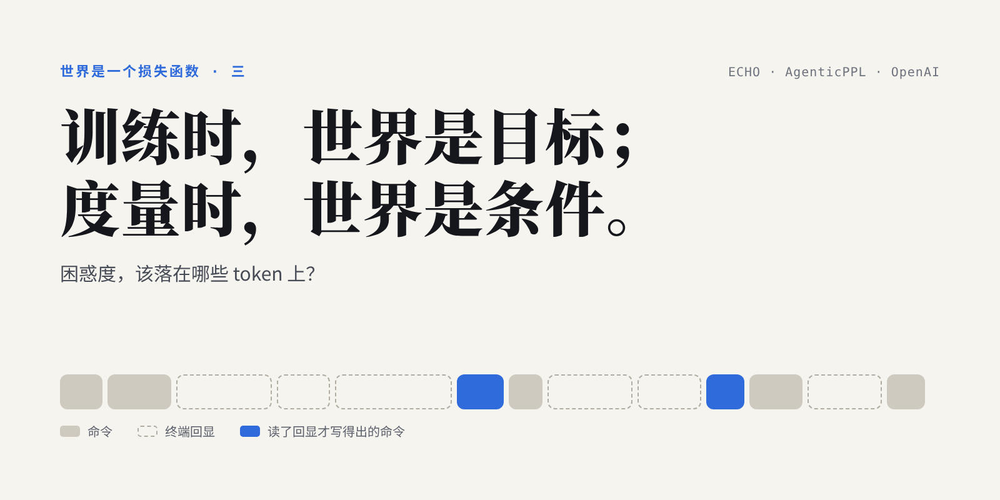
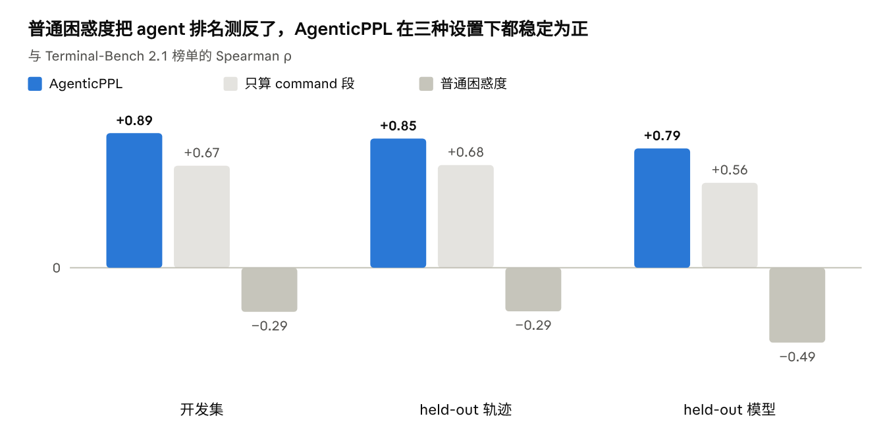
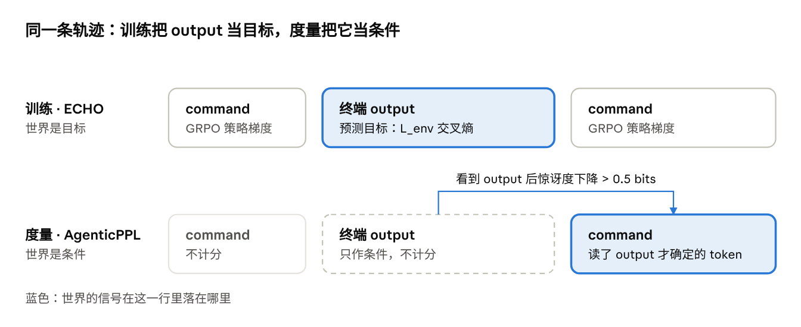
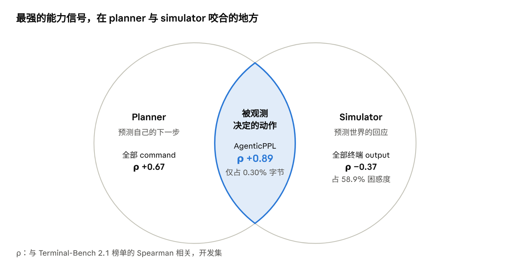

> 困惑度，该落在哪些 token 上？

## 一把没有刻线的尺

困惑度要成为能力的刻度，得先说清楚它落在哪些 token 上。在 agent 轨迹里，这个问题答错了，刻度会直接反过来。

这周 OpenAI 首席科学家 Pachocki 发了《[Perplexity and Intelligence](https://openai.com/index/perplexity-and-intelligence/)》，提议各家实验室用困惑度作为共同的度量衡，来追踪递归自我改进（RSI）的进度。文中的数字是：GPT-3.5 约 0.99，GPT-4 约 0.91，近期模型低于 0.8，预计 0.68–0.70 一带会出现变革性能力。

但这把尺子没有刻线。它的评测集取自 OpenAI 内部代码库，正文不按 token 类型拆分，也没有讨论 agent 轨迹。作者自己承认了一个盲区：思维链能大幅提升能力，却不会降低困惑度。

平均困惑度对每个 token 一视同仁。可在一条 agent 轨迹里，token 并不是同一种东西：有模型自己写下的命令，也有世界回给它的输出。

## 尺子反了

[AgenticPPL](https://wenhaochai.com/blogs/agentic-ppl.html) 在 Terminal-Bench 2.1 上做了一次直接检验：用普通轨迹困惑度给模型排名，和榜单的 Spearman ρ 是 −0.29。排名是反的。

*数据：AgenticPPL 原文 · 开发集 25 个模型，held-out 15 个模型*

按段拆开看，原因很清楚。thought、command、task 段都与榜单正相关，只有终端 output 段是反向的（ρ −0.37），而它恰好占了约 58.9% 的困惑度。

再看具体位置：在 output 处，弱模型倾向于照抄前文出现过的东西，比如主机名；强模型预测的却是自己的下一步。强模型并非不懂终端，只是它太像一个行动者了。

## 金矿，还是噪声

同一批 token，训练时是金矿，度量时却是噪声。

我在[第一篇](https://github.com/Paul33333/tinymind-blog/blob/main/content/blog/%E4%B8%96%E7%95%8C%E6%98%AF%E4%B8%80%E4%B8%AA%E6%8D%9F%E5%A4%B1%E5%87%BD%E6%95%B0%E2%80%94%E2%80%94echo-%E4%B8%8E-grpo-%E4%B8%AD%E9%82%A3%E4%BA%9B%E8%A2%AB%E6%B5%AA%E8%B4%B9%E7%9A%84-token.md)里写过 ECHO：用 GRPO 训练 CLI agent 时，不要把终端输出 mask 掉，而是给它们加上交叉熵。Qwen3-14B 在 TerminalBench-2.0 上的 pass@1 因此从 5.2 升到 10.8。即使完全去掉奖励，只留环境交叉熵，模型仍然会变强。

AgenticPPL 的结论落在同一批 token 上，方向却相反：在这里算困惑度，不但测不出能力，还会把排名测反。

两边都没有错。错在把「损失」和「刻度」当成了同一件事。

## 训练时世界是目标，度量时世界是条件

损失和刻度回答的是两个不同的问题。

*同一条 CLI 轨迹的两种用法 · ECHO 与 AgenticPPL*

**训练是一个模型和过去的自己比。** 同一个模型在 output 上的交叉熵降下来，说明它把「命令 → 后果」的映射学得更好了。ECHO 的离线实验正是这样测的：GRPO 几乎压不动环境 token 的交叉熵，ECHO 能把它明显压下去。

**度量是许多模型之间互相比。** 在 output 位置，谁更像被动的续写器，谁的困惑度就越低；谁更像行动者，谁就越容易被回显吓一跳。所以这里的困惑度量到的更多是模型扮演的角色，而不是它对世界的理解。

ECHO 自己其实已经露出了线索：它计算损失时排除了 harness 警告，因为这类内容很容易被记住。能被记住、被复制的 output，本来就不是世界模型的证据。

所以度量时，世界要从预测目标挪到条件里。AgenticPPL 对每条轨迹算两遍：一遍保留 output，一遍把它换成 `[output hidden]`。由外部评测模型判断，只有看到 output 后惊讶度下降超过 0.5 bits 的 command token 才计分：

$$
\Delta_i \;=\; \ell\big(a_i \mid h_{<i}^{\,\setminus o}\big) \;-\; \ell\big(a_i \mid h_{<i}\big) \;>\; 0.5\ \text{bits}
$$

$$
\mathrm{AgenticPPL} \;=\; -\frac{1}{|S|}\sum_{i \in S} \min\big(\mathrm{ppl}_i,\ 2\big)
$$

Δᵢ 本质上是观测与动作之间的逐点互信息，衡量的是这个动作里有多少信息来自世界。截断到 2 bits 同样关键：一次自信押错可能要付 10–40 bits，不截断的话，它会盖掉大量细小但一致的优势。

## 咬合点

最强的能力信号既不在纯动作上，也不在纯观测上，而在两者咬合的地方。

*数据：AgenticPPL 原文开发集 · 分区为本文的概念归纳*

我在[第二篇](https://github.com/Paul33333/tinymind-blog/blob/main/content/blog/%E4%B8%96%E7%95%8C%E6%98%AF%E4%B8%80%E4%B8%AA%E6%8D%9F%E5%A4%B1%E5%87%BD%E6%95%B0%E7%BB%AD%E2%80%94%E2%80%94%E4%BB%8E-echo-%E5%88%B0-world-model%E4%B9%9F%E8%AE%B8-planner-%E4%B8%8E-simulator-%E4%BB%8E%E6%9D%A5%E4%B8%8D%E6%98%AF%E4%B8%A4%E4%B8%AA%E4%B8%9C%E8%A5%BF.md)里说，planner 与 simulator 也许从来不是两个东西。Transformer 只看到一串 token，哪段是动作、哪段是观测，是训练者事后划的。ECHO 与 GRPO 唯一的差别，只是损失打在哪里。

AgenticPPL 从度量这一侧，给了这句话一个实证版本。单看动作，ρ 是 +0.67；单看观测，ρ 是 −0.37；只看「被观测决定的动作」，ρ 升到 +0.89。而这部分只占全部字节的约 0.30%。

能力不在模型会不会说话，也不在它会不会复述世界，而在它听懂世界之后，下一步做了什么。

## 给尺子补上刻线

困惑度要当 RSI 的度量衡，至少应该标明它的刻线落在哪些 token 上。

OpenAI 这把尺量的是内部代码。代码基本都是作者写下的文本，不含环境回显，所以恰好避开了 AgenticPPL 发现的那种反转。可当被量的文本越来越多是 agent 自己的轨迹时，这种巧合不会一直成立。

Pachocki 自己承认的盲区，或许也和刻线的位置有关。RL 训练的正是「读了反馈再行动」，如果只在被观测决定的动作上算困惑度，后训练带来的提升也许就能在尺子上显形。这还只是假设：AgenticPPL 证明了它能在模型之间排名，还没有证明它能追踪同一个模型在 RL 前后的变化。

这把新尺子也有它的边界：

- **稀疏**：选中的 token 只占约 0.30% 的字节。
- **依赖裁判**：规则由外部评测模型决定。换成 Inkling 2 Mini 重新搜索，规则形状相似，held-out 模型上为 +0.763，但具体选中的 token 重叠较少。
- **只验证了终端**：在浏览器、多工具、长程编程等场景里，能不能找到同类 token，仍是开放问题。

## 三篇，一句话

1. 世界是一个损失函数，别浪费它的每一次回应。
2. Planner 与 simulator 是同一个预测器，差别只在损失打在哪里。
3. 度量时，世界应该是条件，而不是目标。

一把好尺子，量的不是模型能复述多少世界，而是它听懂世界之后做了什么。

## 参考

- [Perplexity and Intelligence](https://openai.com/index/perplexity-and-intelligence/) · OpenAI
- [AgenticPPL](https://wenhaochai.com/blogs/agentic-ppl.html) · Wenhao Chai
- [世界是一个损失函数——ECHO 与 GRPO 中那些被浪费的 token](https://github.com/Paul33333/tinymind-blog/blob/main/content/blog/%E4%B8%96%E7%95%8C%E6%98%AF%E4%B8%80%E4%B8%AA%E6%8D%9F%E5%A4%B1%E5%87%BD%E6%95%B0%E2%80%94%E2%80%94echo-%E4%B8%8E-grpo-%E4%B8%AD%E9%82%A3%E4%BA%9B%E8%A2%AB%E6%B5%AA%E8%B4%B9%E7%9A%84-token.md)
- [世界是一个损失函数（续）——从 ECHO 到 World Model](https://github.com/Paul33333/tinymind-blog/blob/main/content/blog/%E4%B8%96%E7%95%8C%E6%98%AF%E4%B8%80%E4%B8%AA%E6%8D%9F%E5%A4%B1%E5%87%BD%E6%95%B0%E7%BB%AD%E2%80%94%E2%80%94%E4%BB%8E-echo-%E5%88%B0-world-model%E4%B9%9F%E8%AE%B8-planner-%E4%B8%8E-simulator-%E4%BB%8E%E6%9D%A5%E4%B8%8D%E6%98%AF%E4%B8%A4%E4%B8%AA%E4%B8%9C%E8%A5%BF.md)
